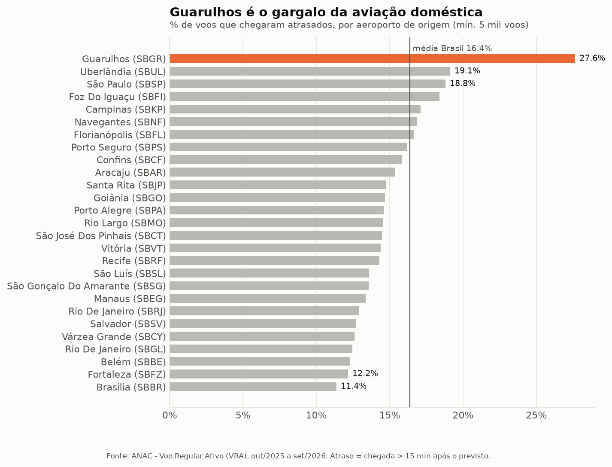
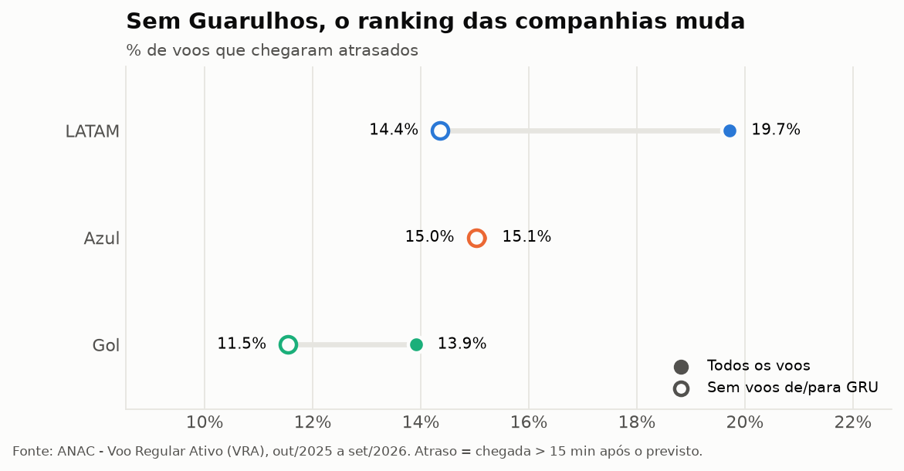
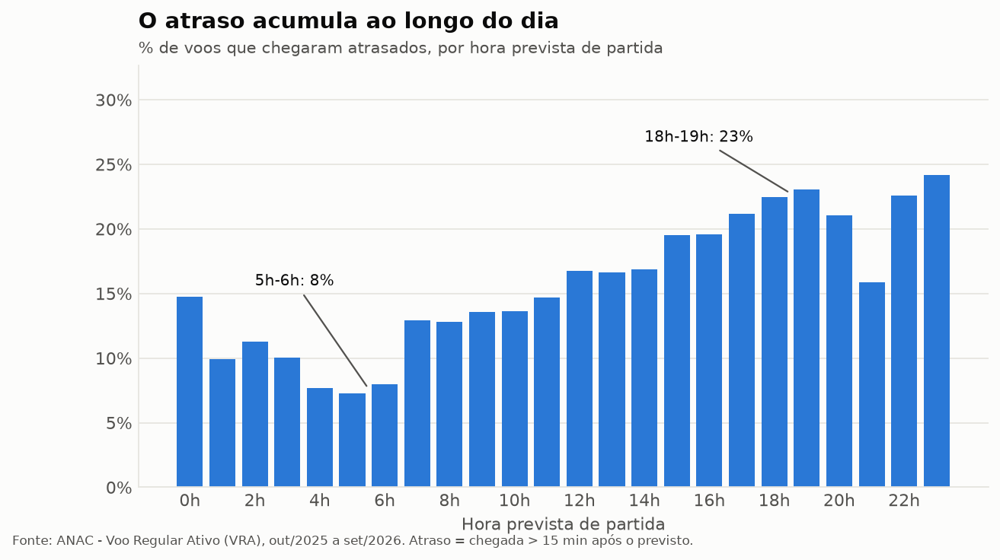
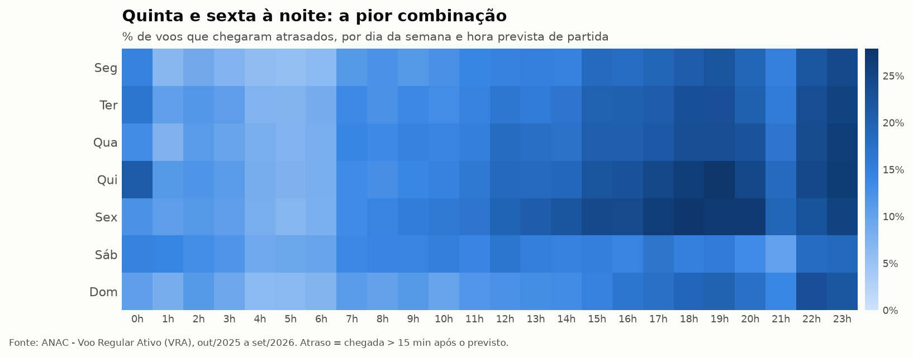
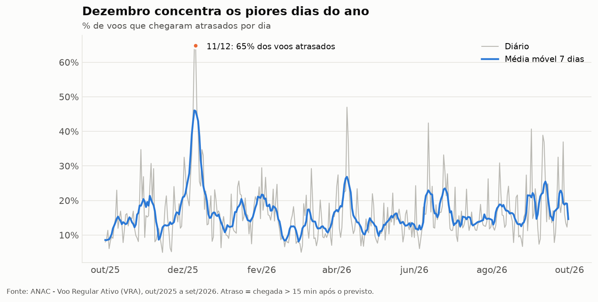

# ✈️ Atrasos de voos no Brasil: onde, quando e quem atrasa

Análise de **810 mil voos domésticos** (out/2025 – set/2026) com dados oficiais da ANAC, usando **Python, SQL (DuckDB) e um pipeline reproduzível** do download dos dados até as recomendações.

> **Resumo:** 1 em cada 6 voos domésticos chega atrasado. O problema se concentra em **Guarulhos**, que atrasa quase o dobro da média nacional, e **cresce ao longo do dia**. Os rankings de pontualidade das companhias **enganam** quando não levam o aeroporto em conta.

📓 **[Ver a análise completa (notebook)](notebooks/analise_atrasos.ipynb)**

---

## Principais resultados

| Indicador | Valor |
|---|---|
| Voos analisados | 780 mil (96% da base) |
| Chegadas com mais de 15 min de atraso | **16,4%** |
| Chegadas com mais de 30 min de atraso | 8,4% |
| Cancelamentos | 1,8% |
| Horas de atraso acumuladas (aeronave) | ~119 mil |

### 1. Guarulhos é o gargalo da aviação doméstica
GRU atrasa **27,6%** dos voos, quase 2× a média nacional, e **as 10 rotas mais atrasadas do país saem de lá**.



### 2. O ranking das companhias engana
No total, a LATAM parece a mais atrasada. Mas 22% das partidas dela saem de GRU, contra 3% da Azul. **Sem os voos de/para Guarulhos, a LATAM passa à frente da Azul.** É um exemplo clássico de variável de confusão. Mesmo assim, *dentro* de GRU a LATAM atrasa 2× mais que a Azul, o que pede um diagnóstico do hub.



### 3. O atraso acumula ao longo do dia
Voos das 5h–6h atrasam **8%**; os das 18h–19h, **23%**. E **80% dos voos que saem atrasados chegam atrasados**: o atraso se decide no solo, não no ar.




### 4. Dezembro concentra os piores dias
De 9 a 13/dez/2025, até **65%** dos voos atrasaram em um único dia.



## Recomendações

| Para quem | Recomendação |
|---|---|
| **GRU Airport / ANAC** | Priorizar GRU em capacidade de pátio e slots, e revisar a programação nos picos |
| **ANAC / imprensa** | Publicar rankings de pontualidade **ajustados por aeroporto** |
| **LATAM** | Diagnóstico do turnaround no hub de Guarulhos |
| **Companhias** | Mais folga entre etapas à tarde e à noite, e aeronaves reserva nos hubs |
| **Passageiros** | Para compromisso ou conexão, preferir o primeiro voo do dia |

---

## Como o projeto funciona

```
ANAC (CSV mensal) ──► src/download.py ──► data/raw/
                                              │
                          sql/01_staging.sql  ▼  tipagem, renomeação, parsing de datas
                          sql/02_marts.sql    ▼  dimensão de aeroportos, tabela fato, regras de negócio
                                     data/voos.duckdb
                                              │
              notebooks/analise_atrasos.ipynb ▼  análise SQL + visualizações (src/graficos.py)
                                    reports/figures/
```

**Decisões técnicas**
- **DuckDB** consulta 1 milhão de linhas direto dos CSVs em segundos, sem precisar de servidor. O SQL escrito aqui é portável para Postgres, BigQuery etc.
- **Camadas staging → marts**, como em projetos com dbt: limpeza estrutural separada das regras de negócio.
- **Qualidade de dados tratada de forma explícita:** voos sem horário previsto, cancelados e com atrasos impossíveis (por exemplo, 31 dias) ficam marcados e fora das métricas, mas não são apagados.
- **Métrica OTP15** (padrão internacional: chegada até 15 min após o previsto). A classificação de 30 min usada pela ANAC também está disponível.

## Como reproduzir

```bash
python -m venv .venv
.venv\Scripts\activate          # Linux/Mac: source .venv/bin/activate
pip install -r requirements.txt

python src/download.py          # baixa out/2025–set/2026 (~300 MB); aceita --inicio/--fim
python src/build_db.py          # cria data/voos.duckdb
jupyter notebook notebooks/analise_atrasos.ipynb
```

## Limitações e próximos passos
- A coluna de justificativa (causa do atraso) vem vazia na base pública, e não há prefixo da aeronave. Por isso a causa é inferida pelos padrões de local e horário.
- Próximos passos: cruzar com dados meteorológicos (METAR/INMET) para separar clima de operação, e criar um modelo que preveja a probabilidade de atraso de um voo.

## Fonte dos dados
[ANAC – Voo Regular Ativo (VRA)](https://siros.anac.gov.br/siros/registros/diversos/vra/), dados abertos do governo federal.
